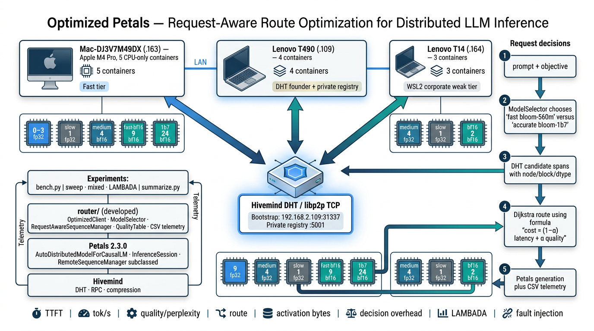
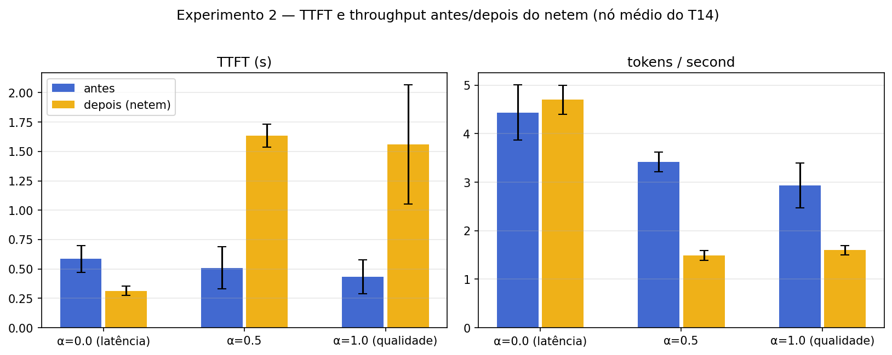
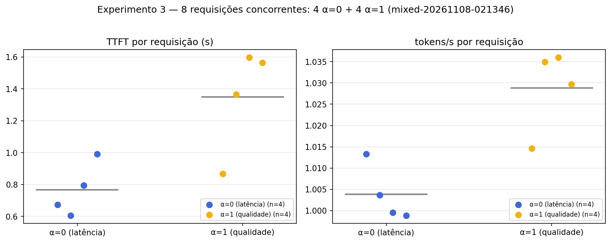
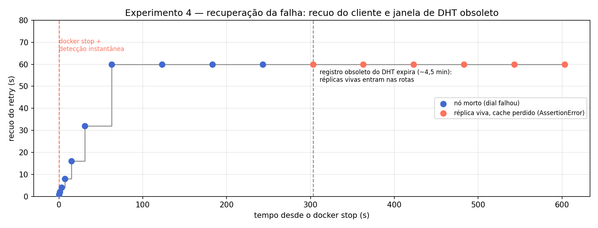
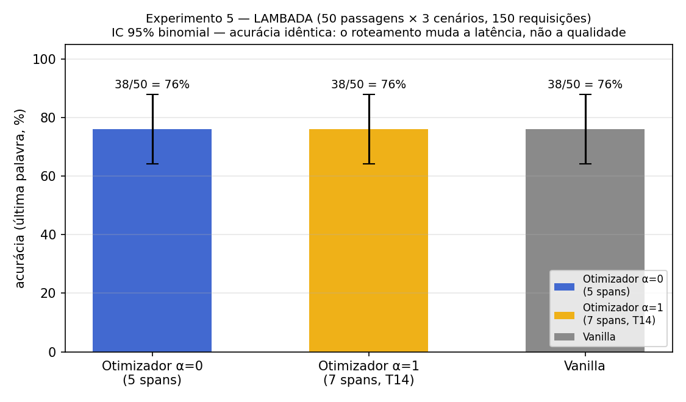

# Nectar: Seleção Objetivo-Consciente de Réplicas para Inferência Distribuída de LLMs em Petals

**Relatório final — MO809A (Unicamp — Tópicos em Computação Distribuída)**
Projeto: *Nectar* — roteador objetivo-consciente para enxames Petals.

---

## 1. Introdução

### 1.1 Tema e problema

Modelos de linguagem de grande porte não cabem em uma única máquina: o Petals
divide um transformer em blocos hospedados em computadores diferentes, e uma
requisição atravessa essa "esteira" de nós em sequência. O roteador padrão do
Petals (`RemoteSequenceManager`) escolhe os servidores otimizando apenas
*throughput e ping* — **toda requisição é roteada da mesma forma**.

Isso ignora que requisições são diferentes entre si: tráfego interativo (chat,
autocompletar) exige **baixa latência**, enquanto sumarização e raciocínio
**toleram mais latência em troca de maior qualidade**. Entre esses extremos
existe um espectro inteiro de objetivos intermediários.

### 1.2 Motivação

O enxame caseiro é heterogêneo por natureza: hardware distinto (GPU Apple
Silicon vs. CPUs x86), precisões distintas (fp32 vs. bf16) e links de rede de
qualidade muito diferente (LAN doméstica vs. rede corporativa). Essa
heterogeneidade — normalmente tratada como limitação — é exatamente o que
torna o roteamento por requisição **útil**: há escolhas reais a fazer a cada
requisição, e escolher bem muda tanto a latência quanto a qualidade percebida.

### 1.3 Objetivos

1. **Estender o roteamento do lado do cliente** do Petals para decidir, *por
   requisição*, quais nós/réplicas usar, a partir de um objetivo declarado:
   minimizar latência (com piso de qualidade) ou maximizar qualidade (com
   orçamento de latência), ou qualquer ponderação intermediária α ∈ [0, 1].
2. **Manter o checkout upstream do Petals intacto** — a extensão vive em um
   pacote separado (`router/`) que subclasseia `RemoteSequenceManager`.
3. **Avaliar a seleção de rota por requisição** sobre latência e um *proxy* de
   qualidade (escore de roteamento); verificar se diferenças do proxy produzem
   diferenças mensuráveis de qualidade de saída.
4. **Medir robustez**: degradação de rede, carga mista concorrente, falha de
   nó em plena geração e acurácia em tarefa real (LAMBADA).

---

## 2. Background

- **Petals**: plataforma open-source de inferência e fine-tuning *colaborativos* de LLMs de
  100B+ (BLOOM, Llama, Falcon, Mixtral). Divide um modelo em blocos hospedados por máquinas
  voluntárias espalhadas pela rede; o cliente conecta ao enxame via DHT e roda a inferência
  passando ativações pela cadeia de servidores. Expõe uma API drop-in do HuggingFace
  (`AutoDistributedModelForCausalLM`) — este projeto estende exatamente o roteador que fica por
  trás dessa API.
- **Hivemind**: biblioteca PyTorch para deep learning descentralizado (projeto
  Learning@home): DHT Kademlia sobre libp2p, all-reduce descentralizado, MoE descentralizado e
  otimizadores tolerantes a falhas. É a base sobre a qual o Petals foi construído: fornece o DHT
  de descoberta e anúncio de blocos e a rede p2p das RPCs cliente↔servidor.
- **Inferência distribuída por pipeline paralelo**: um transformer é cortado
  em blocos consecutivos; cada nó hospeda um intervalo de blocos. Gerar um
  token exige percorrer todos os blocos em ordem — a latência por token é a
  soma dos atrasos de todos os saltos da rota.
- **DHT (Distributed Hash Table)**: o Hivemind usa um DHT Kademlia-style
  (libp2p) para anunciar quais nós hospedam quais blocos e para propagar
  métricas (`ServerInfo`: precisão, RPS de inferência, cache livre, pings).
- **KV cache**: a memória de atenção da geração vive **no servidor** que
  processa o bloco; por isso uma sessão em andamento não pode migrar para
  outro nó em caso de falha.
- **Perplexidade e NLL**: métricas de qualidade — perplexidade por
  (modelo, precisão) medida offline em WikiText-2; divergência do texto gerado
  em relação a uma referência fp32 local (NLL por token e concordância de
  tokens).
- **Fronteira de Pareto**: conjunto de rotas/objetivos em que melhorar uma
  dimensão (latência) só é possível piorando a outra (qualidade). O α ∈ [0, 1]
  percorre essa fronteira: `custo = (1 − α)·latência + α·custo_qualidade`.

---

## 3. Trabalhos Relacionados

| Trabalho | O que faz | Diferença para este projeto |
|---|---|---|
| **Petals** (Borzunov et al., ACL 2023) | Inferência/fine-tuning colaborativo de LLMs de 100B+ | Roteia apenas por throughput/ping, sem objetivo por requisição — este projeto estende exatamente esse ponto |
| **Hivemind / Learning@home** (Ryabinin et al.) | DHT, all-reduce descentralizado, MoE descentralizado | Fornece a infraestrutura de descoberta e tolerância a falhas reutilizada aqui |
| **FlexGen** (Sheng et al., ICML 2023) | Inferência de alto throughput em 1 GPU | Otimiza colocação de tensores em um nó; aqui a otimização é de *rota* entre nós |
| **vLLM / PagedAttention** (Kwon et al., SOSP 2023) | Gerenciamento de memória KV no servidor | Atua no servidor; este projeto atua no cliente, na escolha da rota |
| **Dijkstra / Kademlia** (Maymounkov & Mazières, IPTPS 2002) | Caminhos mínimos; DHT XOR | Base algorítmica do roteador e da descoberta de pares |

**Posicionamento (lacuna de pesquisa).** Sistemas existentes estudam separadamente execução descentralizada de LLMs, roteamento de réplicas, agendamento em recursos heterogêneos, roteamento de modelos e precisão adaptativa — nenhum estabelece a política combinada proposta aqui: seleção por requisição da configuração de execução no Petals (variante de modelo, réplica de bloco, precisão e nó) sob um objetivo explícito de latência vs. qualidade, considerando comunicação, concorrência, falhas e overhead de roteamento. Nesta topologia avaliada, o escore de qualidade não produziu variação mensurável de qualidade de saída; a análise de Pareto reportada deve ser interpretada como trade-off de custo-de-rota/latência, não como uma fronteira de qualidade validada de ponta a ponta.

---

## 4. Proposta

Um **roteador consciente do objetivo**, hierárquico, no cliente:

1. **Nível 1 — seleção de modelo** (`router/selector.py`): dado o objetivo,
   escolher o tier — `bloom-560m` (rápido) vs `bloom-1b7` (preciso) — pela
   latência prevista + pontuação de qualidade do modelo.
2. **Nível 2 — seleção de réplica/bloco** (`router/policy.py`):
   `RequestAwareSequenceManager` subclasseia `RemoteSequenceManager` e espelha
   o grafo de Dijkstra do Petals, mas guarda **latência e qualidade como pesos
   separados**, combinados por requisição:
   `custo = (1 − α)·latência + α·custo_qualidade`.
   Objetivos com restrição (`latency_budget`, `quality_floor`) caminham no peso
   até a rota prevista satisfazer a restrição.
3. **Tabela de qualidade** (`router/quality.py`): perplexidade por
   (modelo, precisão) medida offline em WikiText-2; a precisão de cada réplica
   já vem anunciada no DHT (`ServerInfo.torch_dtype`), então réplicas fp32/bf16
   ficam visíveis no cliente **sem nenhuma mudança no servidor**.
4. **Instrumentação** (`router/instrumentation.py`, `router/client.py`): uma
   linha de CSV por requisição — TTFT, tokens/s, tempo de decisão, rota,
   bytes de ativação estimados, NLL vs. referência fp32, acurácia de tarefa.

**Escalarização multi-objetivo.** A combinação por soma ponderada
(`custo = (1 − α)·latência + α·custo_qualidade`) é a forma mais simples de escalarizar um
objetivo bi-critério e tem interpretação direta como um dial que percorre o espaço de rotas.
Limitação conhecida da técnica — e assumida aqui: soma ponderada não alcança regiões
**não convexas** da fronteira de Pareto. Os objetivos restritos (`latency_budget`,
`quality_floor`) cobrem parcialmente essa lacuna: funcionam como ε-restrição sobre o mesmo
grafo, caminhando no peso até a rota prevista satisfazer a restrição declarada.

O objetivo viaja por requisição num `ContextVar` (o call stack do Petals não
expõe um parâmetro de objetivo até `InferenceSession`), e o tratamento de
falhas do Petals (pares banidos, re-rotação via DHT, `on_request_failure`) é
herdado intacto.

**Alinhamento com aprendizado distribuído.** O Petals foi construído sobre o Hivemind
para inferência *e* fine-tuning distribuídos: além da inferência, ele suporta fine-tuning
distribuído via autograd sequencial pelos mesmos servidores. A extensão aqui apresentada
vive no roteador, compartilhado pelos dois caminhos — inferência e treino — então o
roteamento objetivo-consciente se aplica ao fine-tuning distribuído sem mudança. Em relação
à aprendizagem federada, a diferença estrutural é o particionamento: no FL os clientes têm o
modelo inteiro e trocam gradientes (paralelismo de dados); no Petals cada nó hospeda uma
fração do modelo e trocam ativações em cadeia (pipeline) — a heterogeneidade do enxame
aparece como réplicas em precisão/nó distintos, exatamente o que o roteamento explora.

---

## 5. Metodologia

### 5.1 Testbed

| Componente | Detalhe |
|---|---|
| MacBook M4 Pro (arm64, macOS) | Servidores via MPS; também roda o cliente das medições |
| Lenovo T490 (x86_64, Ubuntu 24.04, 24 GB) | Fundador do enxame (DHT, porta 31337), CPU |
| Lenovo T14 (rede corporativa) | Pior enlace da topologia — alvo dos experimentos 2 e 4 |
| Variantes Docker | 12 nós virtuais em 3 hosts (`docker-swarm/`) |
| Modelos | `bloom-560m` + `bloom-1b7`, 24 blocos cada, réplicas fp32 e bf16 |
| Stack | Petals 2.3.0.dev2 · Hivemind 1.2.0.dev0 (commit fixado) · transformers 4.43.1 · torch (CPU/MPS) |

**Contêineres por computador (12 nós virtuais).** Especificação de cada contêiner
(`docker-swarm/docker-compose.*.yml`). Dentro dos contêineres Linux do Docker Desktop não há
MPS — todos os nós virtuais rodam em CPU.

| Contêiner | Host | Modelo | Blocos | vCPU | RAM | Precisão |
|---|---|---|---|---|---|---|
| mac-fast | Mac M4 Pro | bloom-560m | 9 | 4 | 4 GB | fp32 |
| mac-medium | Mac M4 Pro | bloom-560m | 4 | 2 | 2 GB | fp32 |
| mac-slow | Mac M4 Pro | bloom-560m | 1 | 1 | 1 GB | fp32 |
| mac-fast-bf16 | Mac M4 Pro | bloom-560m | 9 | 4 | 3 GB | bf16 |
| mac-1b7 | Mac M4 Pro | bloom-1b7 | 24 | 4 | 6 GB | bf16 |
| t490-founder | T490 | bloom-560m | 4 | 2 | 2 GB | fp32 (fundador do DHT) |
| t490-slow | T490 | bloom-560m | 1 | 1 | 1 GB | fp32 |
| t490-bf16 | T490 | bloom-560m | 4 | 2 | 2 GB | bf16 |
| t490-1b7 | T490 | bloom-1b7 | 24 | 4 | 6 GB | bf16 |
| t14-medium | T14 | bloom-560m | 4 | 2 | 2 GB | fp32 (alvo de netem/falha, NET_ADMIN) |
| t14-slow | T14 | bloom-560m | 1 | 1 | 1 GB | fp32 (NET_ADMIN) |
| t14-bf16 | T14 | bloom-560m | 2 | 2 | 2 GB | bf16 |

Todos os 5 experimentos medidos rodam no `bloom-560m` — o tier `bloom-1b7` existe no enxame e na
seleção de modelo do roteador, mas não é o caminho exercitado nos experimentos. Modelos pequenos o
bastante para rodar em CPU nos 3 hosts (sem CUDA neste hardware), mantendo o pipeline do Petals
(DHT, divisão de blocos, KV cache) fiel ao upstream.

**Dados de teste.**

| Dado | O que é | Onde é usado |
|---|---|---|
| 3 prompts do dia a dia | "The capital of France is", "Water boils at a temperature of", "The largest planet in the solar system is" — 20 tokens de geração, 5 repetições por nível de α | Experimentos 1 e 3 |
| WikiText-2 | 100 documentos de validação, janela deslizante — perplexidade offline por (modelo, precisão) → tabela consultada pelo roteador | Score de qualidade (proxy) |
| LAMBADA | 50 passagens, exatidão da última palavra | Experimento 5 (150 requisições, 0 erros) |
| Modelo de referência local | Cópia fp32 íntegra do `bloom-560m` no cliente — o "gabarito" | NLL/token e concordância de tokens |

### 5.2 Métricas

TTFT (tempo até o primeiro token) · tokens/s · **tempo de decisão do roteador**
(overhead próprio) · composição da rota (nº de spans, precisão, nós) · bytes de
ativação por token (estimativa) · NLL por token vs. referência fp32 ·
concordância de tokens · acurácia em tarefa (LAMBADA).

### 5.3 Experimentos

| # | Experimento | Protocolo |
|---|---|---|
| 1 | Varredura de α | α = 0 → 1 em 5 passos, mesmos prompts → fronteira de Pareto; vanilla como linha de base |
| 2 | Degradação de rede | `tc netem delay 150ms 50ms loss 2%` no nó médio do T14; antes/depois com α ∈ {0, 0.5, 1} |
| 3 | Carga mista | 8 requisições concorrentes: 4 com α=0 + 4 com α=1, simultâneas |
| 4 | Injeção de falha | `docker stop` de um nó da rota em plena geração; linha do tempo da recuperação |
| 5 | Acurácia (LAMBADA) | 50 passagens × {α=0, α=1, vanilla}; exatidão da última palavra |

---

## 6. Resultados

### 6.1 Experimento 1 — Varredura de α (fronteira de Pareto)

`sweep-20261108-002856.csv`, 18 requisições (3 prompts × 5 α + vanilla):

| α | tokens/s | TTFT (s) | Decisão (ms) | NLL/tok vs fp32 | Concordância |
|---|---|---|---|---|---|
| 0.00 | 4.2 ± 0.0 | 1.29 | 0.5 | 1.133 | 1.00 |
| 0.25 | 4.2 ± 0.3 | 0.65 | 0.4 | 1.133 | 1.00 |
| 0.50 | 4.2 ± 0.2 | 0.95 | 0.3 | 1.133 | 1.00 |
| 0.75 | 4.3 ± 0.5 | 1.07 | 0.4 | 1.133 | 1.00 |
| 1.00 | 3.9 ± 0.2 | 0.75 | 0.3 | 1.133 | 1.00 |
| vanilla | 4.4 ± 0.3 | 0.50 | — | — | — |

**Leitura.** A rota muda de composição ao longo do α: com α=0 a rota usa 5
spans em hosts locais rápidos; com α=1 o roteador inclui o span fp32 do T14 e
a perplexidade prevista cai (22,075 → 22,025) ao custo de tokens/s menores.
**Isso é uma diferença no escore de roteamento, não evidência observada de
texto melhor**: como todas as rotas servem o mesmo modelo, o NLL medido e a
concordância são planos ao longo de todo o α — a dimensão qualidade aparece no
**custo da rota**, não no texto gerado. O overhead de decisão fica entre 0,2 e
0,6 ms por requisição (desprezível).

### 6.2 Experimento 2 — Degradação de rede (netem)

`netem-before.csv` / `netem-after.csv` — 3 requisições por α, antes e depois
de `netem delay 150ms 50ms loss 2%` no nó médio do T14:

| α | TTFT antes → depois | tokens/s antes → depois | Latência prevista antes → depois | Rota mudou? |
|---|---|---|---|---|
| 0.0 | 0.58 → 0.31 s | 4.43 → 4.70 | 0.84 → 0.84 s | Não — **rota não toca o nó degradado, dano zero** |
| 0.5 | 0.51 → 1.63 s (**+220%**) | 3.42 → 1.49 (−56%) | 0.91 → 0.94 s | Não |
| 1.0 | 0.43 → 1.56 s (+263%) | 2.93 → 1.60 (−45%) | 0.91 → 0.98 s | Não |

**Leitura.** O impacto se divide exatamente ao longo do objetivo: a rota de
latência (α=0) não usa o nó degradado e não sofre nada; as rotas de qualidade
(α=0.5/1) passam por ele e **não podem desviar** — os blocos que ele hospeda
têm dono único nesta topologia. A latência prevista quase não reagiu
(0.91 → 0.94 s) enquanto o TTFT real triplicou: a tabela de RTTs do DHT atualiza
lento demais para capturar um atraso súbito. É a limitação honesta do modelo de
custo e aponta para a extensão natural: sondas de RTT por requisição.

### 6.3 Experimento 3 — Carga mista concorrente

`mixed-20261108-021346.csv` — 8 requisições simultâneas (4 α=0 + 4 α=1):

- Rotas **diferenciadas por grupo no mesmo instante**: α=0 → rota larga bf16
  (6 spans via mac-fast-bf16); α=1 → rota de 7 spans pelos spans fp32 do T14.
- TTFT por requisição: 0.61–1.60 s; tempo de decisão: 0.2–1.5 ms; **0 erros**.
- A instrumentação por requisição (ContextVar `current_route`) elimina a
  condição de corrida de leitura do estado compartilhado do gerenciador.

### 6.4 Experimento 4 — Injeção de falha em plena geração

`fault-injection-final.log` — a recuperação se divide em quatro fases medidas:

1. **Detecção instantânea** — o erro de conexão chega no mesmo segundo do
   `docker stop`.
2. **Janela de DHT obsoleto (~5 min)** — o DHT continua anunciando o nó morto;
   as reconstruções de rota continuam escolhendo-o e o cliente recua
   progressivamente (1 → 2 → 4 → … → 60 s).
3. **Autorrecuperação do enxame** — expirado o registro obsoleto, o DHT entrega
   réplicas vivas de substituição e o bloco perdido volta a ser coberto.
4. **A requisição interrompida não migra** — o KV cache vivia no nó que caiu;
   continuar em uma máquina nova falha na checagem de comprimento
   (`AssertionError('0 and N')`) e a requisição nunca completa — enquanto toda
   **requisição nova** funciona na topologia reparada.

**Conclusão do experimento:** o enxame sobrevive; a requisição em voo não.
Aponta diretamente para a extensão natural: reenviar o prefixo ao novo dono do
bloco no failover.

### 6.5 Experimento 5 — Acurácia em tarefa real (LAMBADA)

`lambada-20261108-023638.csv` — 50 passagens × 3 cenários, 150 requisições, 0 erros:

| Cenário | Rota | TTFT | tokens/s | Acurácia (`task_match`) |
|---|---|---|---|---|
| Otimizador α=0 | 5 spans | 0.96 s | 2.65 | 38/50 = **76%** |
| Otimizador α=1 | 7 spans, **via T14 fp32** | 1.35 s | 2.02 | 38/50 = **76%** |
| Vanilla | — | 0.93 s | 2.57 | 38/50 = **76%** |

**Leitura.** O roteamento muda a **latência, não a acurácia**: a rota de
qualidade (α=1) paga +40% de TTFT e −24% de throughput para atravessar os
spans fp32 remotos, mas a acurácia é idêntica — mesmo modelo (bloom-560m) e
decodificação gulosa determinística produzem o mesmo texto em qualquer rota.
O ganho de qualidade potencial (blocos em precisão total) aparece no custo da
rota, não no acerto. Overhead de decisão: 0.37–0.44 ms.

---

## 7. Conclusão

### 7.1 Síntese

O projeto demonstra **roteamento objetivo-consciente de réplicas por
requisição**, no cliente, usando um grafo de custo latência–qualidade
configurável — sem tocar o código upstream. Neste testbed, a política mudou
rotas e comportamento de latência, **mas não produziu diferenças mensuráveis
de qualidade de saída** (todas as rotas avaliadas serviram o mesmo modelo e
geraram saídas equivalentes sob decodificação determinística); a validação de
uma fronteira de Pareto latência–qualidade de ponta a ponta fica como trabalho
futuro, exigindo alternativas de execução com diferenças observáveis de
qualidade. As medições mostram:

- o overhead da decisão é desprezível (0.2–1.5 ms por requisição);
- rotas diferenciadas coexistem sob carga concorrente sem degradação mútua;
- rotas diferenciadas absorvem danos de rede onde o nó degradado não é
  necessário — e não podem evitá-lo quando ele é o único dono dos blocos;
- o trade-off latência × qualidade com modelo fixo aparece em **latência e
  custo de rota**, não em acurácia de tarefa;
- a tolerância a falhas herdada do Petals funciona, mas a sessão em voo não
  migra (KV cache é do servidor).

### 7.2 Ameaças à validade

- **Amostras pequenas**: 18 requisições na varredura de α (3 prompts × 5 α + vanilla),
  50 passagens LAMBADA, 3 requisições por α no netem — sem intervalos de confiança; a
  varredura é de sanidade da mecânica, não caracterização fina da fronteira.
- **Topologia única**: um enxame de 3 hosts com blocos de dono único; as conclusões de
  desvio e reatividade de telemetria dependem da topologia e devem ser reavaliadas em
  enxames com réplicas sobrepostas.
- **Qualidade como proxy**: a dimensão qualidade é o escore de roteamento (perplexidade
  offline); não houve diferença mensurável de qualidade de saída (mesmo modelo,
  decodificação gulosa determinística).
- **Telemetria defasada**: a tabela de RTTs do DHT atualiza por ping com janela longa — a
  latência prevista não capturou o atraso injetado; as conclusões sobre reatividade valem
  para esse regime de atualização.
- **Escopo do modelo**: BLOOM-560m/1b7 em CPU/MPS (sem CUDA, sem quantização);
  comportamento com modelos maiores e aceleradores dedicados não foi medido.

### 7.3 Trabalhos futuros

1. **Sondas de RTT por requisição** (ou atualizações de DHT dirigidas a
   eventos) para reagir a mudanças de rede em segundos, não minutos.
2. **Failover de sessão**: reenviar o prefixo ao novo dono do bloco,
   reconstruindo o KV cache — fecha a lacuna do experimento 4.
3. **Réplicas com donos múltiplos** na topologia para exercitar o desvio de
   rota sob degradação (o experimento 2 ficou limitado por donos únicos).
4. **Quantização** (8-bit/NF4) como terceiro eixo de qualidade — exige GPU CUDA.
5. **Validação de uma fronteira latência–qualidade de ponta a ponta**: exige
   alternativas de execução com diferenças observáveis de qualidade (réplicas
   com donos múltiplos, variantes de modelo com qualidade distinta)
   selecionadas por requisição — mais amostras por α e comparação formal
   contra as baselines sempre-rápido e sempre-preciso.

---

## 8. Referências (formato SBC)

1. BORZUNOV, A.; MAXIMOV, V.; RYABININ, M. et al. **Petals: Collaborative Inference and Fine-tuning of Large Models**. In: Proceedings of the 61st Annual Meeting of the Association for Computational Linguistics (ACL 2023), 2023.
2. RYABININ, M.; BORZUNOV, A.; GORBUNOV, A. et al. **Distributed Deep Learning in Open Collaborations**. In: Advances in Neural Information Processing Systems (NeurIPS 2023), 2023.
3. RYABININ, M.; GUSEV, A. **Learning@home: Crowdsourced Training of Large Neural Networks using Decentralized Mixture-of-Experts**. In: NeurIPS Workshop on Distributed Machine Learning, 2020.
4. MAYMOUNKOV, P.; MAZIÈRES, D. **Kademlia: A Peer-to-peer Information System Based on the XOR Metric**. In: IPTPS, 2002.
5. VASWANI, A. et al. **Attention Is All You Need**. In: NeurIPS, 2017.
6. LE SCAO, T. et al. **BLOOM: A 176B-Parameter Open-Access Multilingual Language Model**. arXiv:2211.05100, 2022.
7. KWON, W. et al. **Efficient Memory Management for Large Language Model Serving with PagedAttention**. In: SOSP, 2023.
8. SHENG, Y. et al. **FlexGen: High-Throughput Generative Inference on Single GPU**. In: ICML, 2023.
9. PAPAMARTZIVANOS, D. et al. **LAMBADA (Linguistic Analysis of Multi-word Ambiguities in Discourse) — Evaluation of Language Models on Broad-Context Reasoning**. ACL 2016.
