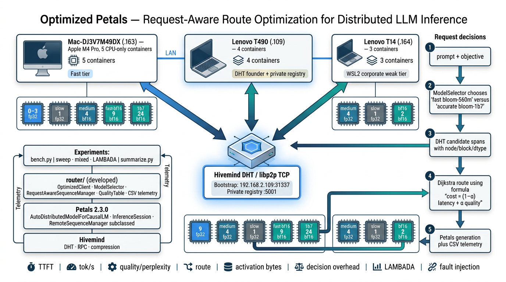
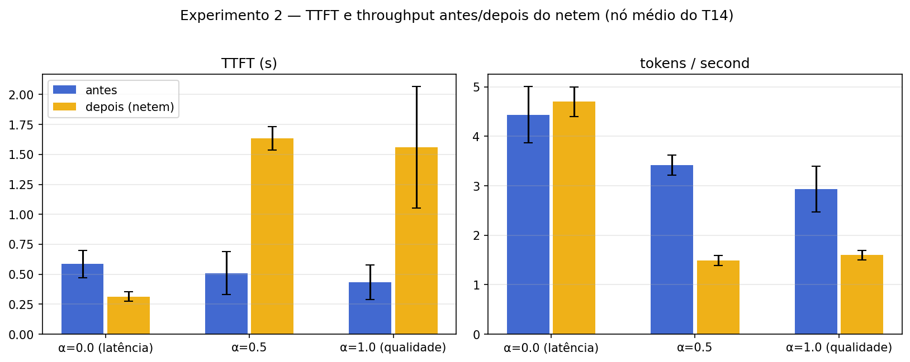
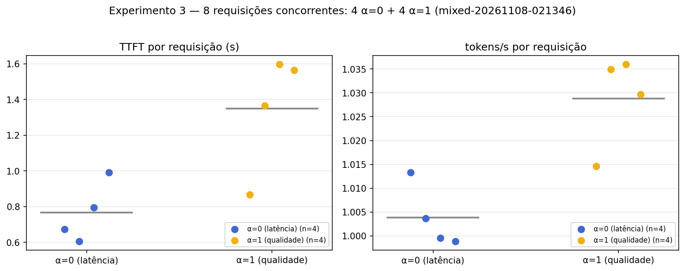
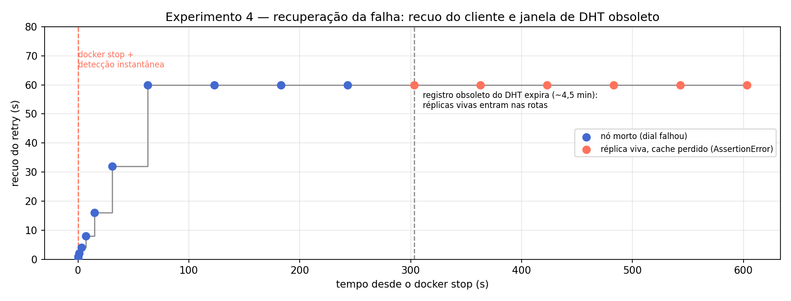
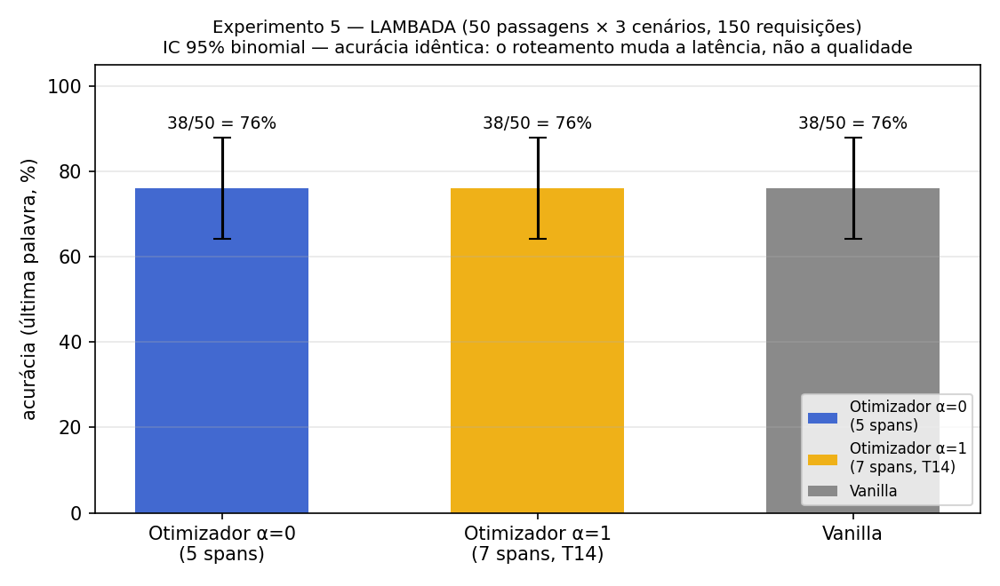

# Nectar: Objective-Aware Replica Selection for Distributed LLM Inference in Petals

**Final report — MO809A (Unicamp — Topics in Distributed Computing)**
Project: *Nectar* — an objective-aware router for Petals swarms.
(Also available in [Portuguese — `RELATORIO.md`](RELATORIO.md).)

---

## 1. Introduction

### 1.1 Topic and problem

Large language models do not fit on a single machine: Petals splits a
transformer into blocks hosted on different computers, and a request traverses
that node chain in sequence. Petals' default router (`RemoteSequenceManager`)
picks servers optimizing only *throughput and ping* — **every request is
routed identically**.

This ignores the fact that requests differ: interactive traffic (chat,
autocomplete) needs **low latency**, while summarization and reasoning
**tolerate more latency in exchange for higher quality**. Between these
extremes lies a whole spectrum of intermediate objectives.

### 1.2 Motivation

A home swarm is heterogeneous by nature: distinct hardware (Apple Silicon GPU
vs. x86 CPUs), distinct precisions (fp32 vs. bf16), and network links of very
different quality (home LAN vs. corporate network). That heterogeneity —
usually treated as a limitation — is exactly what makes per-request routing
**useful**: there are real choices to make on every request, and choosing well
changes both latency and perceived quality.

### 1.3 Objectives

1. **Extend Petals' client-side routing** to decide, *per request*, which
   nodes/replicas to use, based on a declared objective: minimize latency
   (subject to a quality floor), maximize quality (within a latency budget),
   or any intermediate weighting α ∈ [0, 1].
2. **Keep the upstream Petals checkout untouched** — the extension lives in a
   separate package (`router/`) that subclasses `RemoteSequenceManager`.
3. **Evaluate per-request route selection** across latency and a quality
   *proxy* (the routing score); assess whether proxy differences yield
   measurable output-quality differences.
4. **Measure robustness**: network degradation, concurrent mixed load,
   mid-generation node failure, and accuracy on a real task (LAMBADA).

---

## 2. Background

- **Petals**: an open-source platform for *collaborative* inference and fine-tuning of 100B+
  LLMs (BLOOM, Llama, Falcon, Mixtral). It splits a model into blocks hosted by volunteer
  machines across the network; the client connects to the swarm via the DHT and runs inference
  by passing activations through the chain of servers. It exposes a drop-in HuggingFace API
  (`AutoDistributedModelForCausalLM`) — this project extends exactly the router that sits
  behind that API.
- **Hivemind**: a PyTorch library for decentralized deep learning (the Learning@home
  project): a Kademlia DHT over libp2p, decentralized all-reduce, decentralized MoE, and
  fault-tolerant optimizers. It is the foundation Petals was built on: it provides the DHT for
  block discovery and announcement, and the p2p network for the client↔server RPCs.
- **Distributed inference via pipeline parallelism**: a transformer is cut
  into consecutive blocks; each node hosts a range of blocks. Generating one
  token requires traversing all blocks in order — per-token latency is the
  sum of every hop's delay along the route.
- **DHT (Distributed Hash Table)**: Hivemind runs a Kademlia-style DHT
  (libp2p) to announce which nodes host which blocks and to propagate metrics
  (`ServerInfo`: dtype, inference RPS, free cache, pings).
- **KV cache**: the generation's attention memory lives **on the server**
  processing the block; that is why an in-flight session cannot migrate to
  another node on failure.
- **Perplexity and NLL**: quality metrics — offline perplexity per
  (model, precision) measured on WikiText-2; divergence of the generated text
  from a local fp32 reference (NLL per token and token agreement).
- **Pareto frontier**: the set of routes/objectives where improving one
  dimension (latency) is only possible by worsening the other (quality). The
  α ∈ [0, 1] dial traverses that frontier:
  `cost = (1 − α)·latency + α·quality_cost`.

---

## 3. Related Work

| Work | What it does | Difference to this project |
|---|---|---|
| **Petals** (Borzunov et al., ACL 2023) | Collaborative inference/fine-tuning of 100B+ LLMs | Routes only by throughput/ping, with no per-request objective — this project extends exactly that point |
| **Hivemind / Learning@home** (Ryabinin et al.) | DHT, decentralized all-reduce, decentralized MoE | Provides the discovery and fault-tolerance infrastructure reused here |
| **FlexGen** (Sheng et al., ICML 2023) | High-throughput inference on 1 GPU | Optimizes tensor placement on one node; here the optimization is the *route* across nodes |
| **vLLM / PagedAttention** (Kwon et al., SOSP 2023) | Server-side KV memory management | Acts on the server; this project acts on the client, choosing the route |
| **Dijkstra / Kademlia** (Maymounkov & Mazières, IPTPS 2002) | Shortest paths; XOR DHT | Algorithmic basis of the router and peer discovery |

**Positioning (research gap).** Existing systems separately study decentralized LLM execution, replica routing, heterogeneous-resource scheduling, model routing, and adaptive precision; none establishes the combined policy proposed here: per-request selection of a Petals execution configuration (model variant, block replica, precision, and node) under an explicit latency-versus-quality objective, accounting for communication, concurrency, failures, and routing overhead. In the evaluated topology, quality-aware scoring did not produce measurable output-quality variation; the reported Pareto analysis should therefore be interpreted as a route-cost/latency trade-off rather than a validated end-to-end quality frontier.

---

## 4. Proposal

An **objective-aware router**, hierarchical, on the client:

1. **Level 1 — model selection** (`router/selector.py`): given the objective,
   pick the tier — `bloom-560m` (fast) vs `bloom-1b7` (accurate) — by
   predicted latency + model quality score.
2. **Level 2 — replica/block selection** (`router/policy.py`):
   `RequestAwareSequenceManager` subclasses `RemoteSequenceManager` and
   mirrors Petals' Dijkstra graph, but keeps **latency and quality as separate
   edge weights**, combined per request:
   `cost = (1 − α)·latency + α·quality_cost`.
   Constrained objectives (`latency_budget`, `quality_floor`) walk the weight
   until the predicted route satisfies the constraint.
3. **Quality table** (`router/quality.py`): offline perplexity per
   (model, precision) on WikiText-2; each replica's dtype is already announced
   to the DHT (`ServerInfo.torch_dtype`), so fp32/bf16 replicas are
   client-visible with **zero server-side changes**.
4. **Instrumentation** (`router/instrumentation.py`, `router/client.py`): one
   CSV row per request — TTFT, tok/s, decision time, route, estimated
   activation bytes, NLL vs fp32 reference, task accuracy.

**Multi-objective scalarization.** The weighted-sum combination
(`cost = (1 − α)·latency + α·quality_cost`) is the simplest way to scalarize a bi-criteria
objective and reads directly as a dial across the route space. A known limitation of the
technique — accepted here: weighted sums cannot reach **non-convex** regions of the Pareto
frontier. The constrained objectives (`latency_budget`, `quality_floor`) partially cover
this gap: they act as ε-constraints over the same graph, walking the weight until the
predicted route satisfies the declared constraint.

The objective travels per request in a `ContextVar` (Petals' call stack does
not expose an objective parameter up to `InferenceSession`), and Petals'
failure handling (banned peers, DHT rerouting, `on_request_failure`) is
inherited unchanged.

**Alignment with distributed learning.** Petals was built on Hivemind for distributed
inference *and* fine-tuning: beyond inference, it supports distributed fine-tuning via
sequential autograd across the same servers. The extension presented here lives in the
router, shared by both paths — inference and training — so objective-aware routing applies
to distributed fine-tuning unchanged. Relative to federated learning, the structural
difference is the partitioning: in FL clients hold the full model and exchange gradients
(data parallelism); in Petals each node hosts a slice of the model and they exchange
activations in a chain (pipeline) — the swarm's heterogeneity shows up as replicas in
distinct precisions/nodes, exactly what the routing exploits.

---

## 5. Methodology

### 5.1 Testbed

| Component | Detail |
|---|---|
| MacBook M4 Pro (arm64, macOS) | Servers via MPS; also runs the measurement client |
| Lenovo T490 (x86_64, Ubuntu 24.04, 24 GB) | Swarm founder (DHT, port 31337), CPU |
| Lenovo T14 (corporate network) | Worst link in the topology — target of experiments 2 and 4 |
| Docker variant | 12 virtual nodes across 3 hosts (`docker-swarm/`) |
| Models | `bloom-560m` + `bloom-1b7`, 24 blocks each, fp32 and bf16 replicas |
| Stack | Petals 2.3.0.dev2 · Hivemind 1.2.0.dev0 (pinned commit) · transformers 4.43.1 · torch (CPU/MPS) |

**Containers per computer (12 virtual nodes).** Spec of each container
(`docker-swarm/docker-compose.*.yml`). Linux containers inside Docker Desktop have no MPS —
all virtual nodes run on CPU.

| Container | Host | Model | Blocks | vCPU | RAM | Precision |
|---|---|---|---|---|---|---|
| mac-fast | Mac M4 Pro | bloom-560m | 9 | 4 | 4 GB | fp32 |
| mac-medium | Mac M4 Pro | bloom-560m | 4 | 2 | 2 GB | fp32 |
| mac-slow | Mac M4 Pro | bloom-560m | 1 | 1 | 1 GB | fp32 |
| mac-fast-bf16 | Mac M4 Pro | bloom-560m | 9 | 4 | 3 GB | bf16 |
| mac-1b7 | Mac M4 Pro | bloom-1b7 | 24 | 4 | 6 GB | bf16 |
| t490-founder | T490 | bloom-560m | 4 | 2 | 2 GB | fp32 (DHT founder) |
| t490-slow | T490 | bloom-560m | 1 | 1 | 1 GB | fp32 |
| t490-bf16 | T490 | bloom-560m | 4 | 2 | 2 GB | bf16 |
| t490-1b7 | T490 | bloom-1b7 | 24 | 4 | 6 GB | bf16 |
| t14-medium | T14 | bloom-560m | 4 | 2 | 2 GB | fp32 (netem/fault target, NET_ADMIN) |
| t14-slow | T14 | bloom-560m | 1 | 1 | 1 GB | fp32 (NET_ADMIN) |
| t14-bf16 | T14 | bloom-560m | 2 | 2 | 2 GB | bf16 |

All 5 measured experiments run on `bloom-560m` — the `bloom-1b7` tier exists in the swarm and in
the router's model-selection level, but is not the exercised path in the experiments. The models
are small enough to run CPU-only on the 3 hosts (no CUDA on this hardware), keeping the Petals
pipeline (DHT, block splits, KV cache) faithful to upstream.

**Test data.**

| Data | What it is | Where it's used |
|---|---|---|
| 3 everyday prompts | "The capital of France is", "Water boils at a temperature of", "The largest planet in the solar system is" — 20 generated tokens, 5 repetitions per α level | Experiments 1 and 3 |
| WikiText-2 | 100 validation documents, sliding window — offline perplexity per (model, precision) → lookup table consulted by the router | Quality score (proxy) |
| LAMBADA | 50 passages, exact-match on the last word | Experiment 5 (150 requests, 0 errors) |
| Local reference model | Pristine fp32 copy of `bloom-560m` kept on the client — the "answer key" | NLL/token and token agreement |

### 5.2 Metrics

TTFT (time to first token) · tok/s · **router decision time** (own overhead) ·
route composition (span count, precision, nodes) · activation bytes per token
(estimate) · NLL per token vs fp32 reference · token agreement · task accuracy
(LAMBADA).

### 5.3 Experiments

| # | Experiment | Protocol |
|---|---|---|
| 1 | α sweep | α = 0 → 1 in 5 steps, same prompts → Pareto frontier; vanilla baseline |
| 2 | Network degradation | `tc netem delay 150ms 50ms loss 2%` on the T14's medium node; before/after with α ∈ {0, 0.5, 1} |
| 3 | Mixed load | 8 concurrent requests: 4 with α=0 + 4 with α=1, simultaneous |
| 4 | Fault injection | `docker stop` of a route node mid-generation; recovery timeline |
| 5 | Accuracy (LAMBADA) | 50 passages × {α=0, α=1, vanilla}; exact-match on the last word |

---

## 6. Results

### 6.1 Experiment 1 — α sweep (Pareto frontier)

`sweep-20261108-002856.csv`, 18 requests (3 prompts × 5 α + vanilla):

| α | tok/s | TTFT (s) | Decision (ms) | NLL/tok vs fp32 | Agreement |
|---|---|---|---|---|---|
| 0.00 | 4.2 ± 0.0 | 1.29 | 0.5 | 1.133 | 1.00 |
| 0.25 | 4.2 ± 0.3 | 0.65 | 0.4 | 1.133 | 1.00 |
| 0.50 | 4.2 ± 0.2 | 0.95 | 0.3 | 1.133 | 1.00 |
| 0.75 | 4.3 ± 0.5 | 1.07 | 0.4 | 1.133 | 1.00 |
| 1.00 | 3.9 ± 0.2 | 0.75 | 0.3 | 1.133 | 1.00 |
| vanilla | 4.4 ± 0.3 | 0.50 | — | — | — |

**Reading.** The route changes composition across α: with α=0 the route uses
5 spans on fast local hosts; with α=1 the router includes the T14's fp32 span
and the predicted perplexity drops (22,075 → 22,025) at the cost of lower
tok/s. **This is a routing-score difference, not observed evidence of better
text**: since every route serves the same model, the quality dimension shows
up in the **route cost**, not in the generated text.
Decision overhead stays between 0.2 and 0.6 ms per request (negligible).

### 6.2 Experiment 2 — Network degradation (netem)

`netem-before.csv` / `netem-after.csv` — 3 requests per α, before and after
`netem delay 150ms 50ms loss 2%` on the T14's medium node:

| α | TTFT before → after | tok/s before → after | Predicted latency before → after | Route changed? |
|---|---|---|---|---|
| 0.0 | 0.58 → 0.31 s | 4.43 → 4.70 | 0.84 → 0.84 s | No — **route doesn't touch the degraded node, zero damage** |
| 0.5 | 0.51 → 1.63 s (**+220%**) | 3.42 → 1.49 (−56%) | 0.91 → 0.94 s | No |
| 1.0 | 0.43 → 1.56 s (+263%) | 2.93 → 1.60 (−45%) | 0.91 → 0.98 s | No |

**Reading.** The impact splits exactly along the objective: the latency route
(α=0) doesn't use the degraded node and takes no damage; the quality routes
(α=0.5/1) go straight through it and **cannot detour** — the blocks it hosts
have single holders in this topology. The predicted latency barely reacted
(0.91 → 0.94 s) while actual TTFT tripled: the DHT's ping-based RTT table
refreshes too slowly to capture a sudden injected delay. **The failure to
detour is a topology constraint, not a router failure**: with a single holder
for the required blocks, no client-side routing algorithm can bypass the
node. Adaptive routing only provides resilience when the swarm exposes
genuine alternatives — overlapping block replicas with sufficiently current
telemetry — and the natural extension is per-request RTT probes.

### 6.3 Experiment 3 — Concurrent mixed load

`mixed-20261108-021346.csv` — 8 simultaneous requests (4 α=0 + 4 α=1):

- Routes **differentiated per group at the same instant**: α=0 → wide bf16
  route (6 spans via mac-fast-bf16); α=1 → 7-span route through the T14's
  fp32 spans.
- Per-request TTFT: 0.61–1.60 s; decision time: 0.2–1.5 ms; **0 errors**.
- Per-request instrumentation (the `current_route` ContextVar) eliminates the
  race of reading the shared manager's state after generation.

### 6.4 Experiment 4 — Mid-generation fault injection

`fault-injection-final.log` — recovery splits into four measured phases:

1. **Instant detection** — the connection error lands in the same second as
   the `docker stop`.
2. **Stale-DHT window (~5 min)** — the DHT keeps advertising the dead node;
   route rebuilds keep picking it and the client backs off progressively
   (1 → 2 → 4 → … → 60 s).
3. **Swarm self-recovery** — once the stale record expires, the DHT hands out
   live replacement replicas and the lost block is covered again.
4. **The interrupted request cannot migrate** — the KV cache lived on the node
   that died; continuing on a fresh machine fails a length check
   (`AssertionError('0 and N')`) and the request never completes — while every
   **new** request works fine on the repaired topology.

**Experiment conclusion:** the swarm survives; the in-flight request does not.
This points directly at the natural extension: re-sending the prefix to the
new block holder on failover.

### 6.5 Experiment 5 — Real-task accuracy (LAMBADA)

`lambada-20261108-023638.csv` — 50 passages × 3 scenarios, 150 requests,
0 errors:

| Scenario | Route | TTFT | tok/s | Accuracy (`task_match`) |
|---|---|---|---|---|
| Optimizer α=0 | 5 spans | 0.96 s | 2.65 | 38/50 = **76%** |
| Optimizer α=1 | 7 spans, **via T14 fp32** | 1.35 s | 2.02 | 38/50 = **76%** |
| Vanilla | — | 0.93 s | 2.57 | 38/50 = **76%** |

**Reading.** Routing changes **latency, not accuracy**: the quality route
(α=1) pays +40% TTFT and −24% throughput to traverse the remote fp32 spans,
but accuracy is identical — the same model (bloom-560m) with deterministic
greedy decoding produces the same text on any route. The potential quality
gain (full-precision blocks) shows up in route cost, not in exact-match.
Decision overhead: 0.37–0.44 ms.

---

## 7. Conclusion

### 7.1 Summary

The project demonstrates **objective-aware, client-side, per-request replica
routing** using a configurable latency–quality cost graph, without touching
upstream code. In this testbed the policy changed routes and latency
behavior, **but did not yield measurable output-quality differences** (every
evaluated route served the same model and produced equivalent outputs under
deterministic decoding); validating an end-to-end latency–quality Pareto
frontier remains future work, requiring execution alternatives with
observable quality differences. The measurements show:

- decision overhead is negligible (0.2–1.5 ms per request);
- differentiated routes coexist under concurrent load without mutual
  degradation;
- differentiated routes absorb network damage where the degraded node isn't
  needed — and cannot avoid it when it is the sole holder of the blocks;
- the latency × quality trade-off with a fixed model shows up in **latency and
  route cost**, not in task accuracy;
- the fault tolerance inherited from Petals works, but the in-flight session
  does not migrate (the KV cache is server-side).

### 7.2 Threats to validity

- **Small samples**: 18 requests in the α sweep (3 prompts × 5 α + vanilla), 50 LAMBADA
  passages, 3 requests per α under netem — no confidence intervals; the sweep is a sanity
  check of the mechanism, not a fine characterization of the frontier.
- **Single topology**: a 3-host swarm with single-holder blocks; the detour and telemetry
  reactivity conclusions depend on the topology and should be re-evaluated on swarms with
  overlapping replicas.
- **Quality as a proxy**: the quality dimension is the routing score (offline perplexity);
  no measurable output-quality difference was observed (same model, deterministic greedy
  decoding).
- **Stale telemetry**: the DHT's RTT table refreshes by ping with a long window — the
  predicted latency did not capture the injected delay; the reactivity conclusions hold for
  this update regime.
- **Model scope**: BLOOM-560m/1b7 on CPU/MPS (no CUDA, no quantization); behavior with
  larger models and dedicated accelerators was not measured.

### 7.3 Future work

1. **Per-request RTT probes** (or event-driven DHT updates) to react to
   network changes in seconds, not minutes.
2. **Session failover**: re-send the prefix to the new block holder,
   rebuilding the KV cache — closes the gap found in experiment 4.
3. **Multiple-holder replicas** in the topology to exercise route detours
   under degradation (experiment 2 was limited by single holders).
4. **Quantization** (8-bit/NF4) as a third quality axis — requires a CUDA GPU.
5. **Validation of an end-to-end latency–quality frontier**: requires
   execution alternatives with observable quality differences (multiple-
   holder replicas, model variants of distinct quality) selected per
   request — more samples per α and a formal comparison against the
   always-fast and always-accurate baselines.

---

## 8. References (SBC format)

1. BORZUNOV, A.; MAXIMOV, V.; RYABININ, M. et al. **Petals: Collaborative Inference and Fine-tuning of Large Models**. In: Proceedings of the 61st Annual Meeting of the Association for Computational Linguistics (ACL 2023), 2023.
2. RYABININ, M.; BORZUNOV, A.; GORBUNOV, A. et al. **Distributed Deep Learning in Open Collaborations**. In: Advances in Neural Information Processing Systems (NeurIPS 2023), 2023.
3. RYABININ, M.; GUSEV, A. **Learning@home: Crowdsourced Training of Large Neural Networks using Decentralized Mixture-of-Experts**. In: NeurIPS Workshop on Distributed Machine Learning, 2020.
4. MAYMOUNKOV, P.; MAZIÈRES, D. **Kademlia: A Peer-to-peer Information System Based on the XOR Metric**. In: IPTPS, 2002.
5. VASWANI, A. et al. **Attention Is All You Need**. In: NeurIPS, 2017.
6. LE SCAO, T. et al. **BLOOM: A 176B-Parameter Open-Access Multilingual Language Model**. arXiv:2211.05100, 2022.
7. KWON, W. et al. **Efficient Memory Management for Large Language Model Serving with PagedAttention**. In: SOSP, 2023.
8. SHENG, Y. et al. **FlexGen: High-Throughput Generative Inference on Single GPU**. In: ICML, 2023.
9. PAPAMARTZIVANOS, D. et al. **LAMBADA (Linguistic Analysis of Multi-word Ambiguities in Discourse) — Evaluation of Language Models on Broad-Context Reasoning**. ACL 2016.
